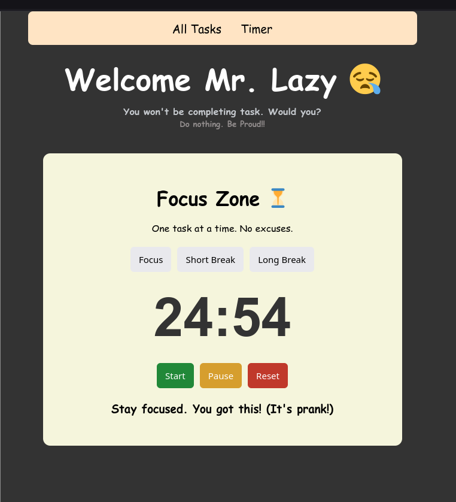
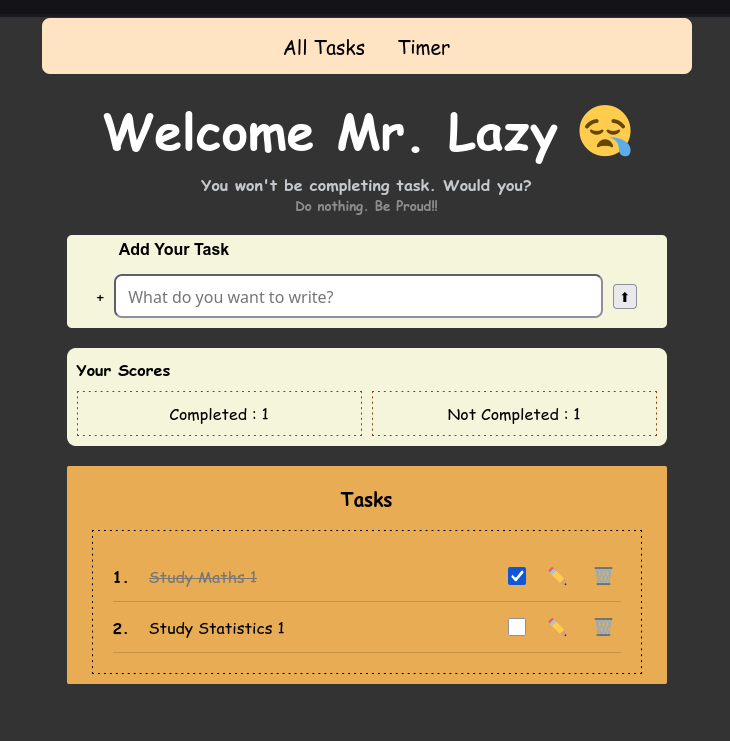

# Kanban-Task-Board
It is a simple program built for two things :
- Set a Pomodore Clock
- To-do list

## Tech Stack:
1. HTML5
2. CSS (Vanilla)
3. JavaScript 

## Features:
1. Helps you set up a small pomodoro timer. 
2. Helps you write yoru task list.

*Best part? It have local storage, so it can contain the info you added to it even after reloading.🤩🤩*

## Personal motivation:
My personal motivation for creating this small website was to make my task easier. Literally if you want a pomodoro timer with a todo list, you need to install two separate app. Or, more often, they start showing you ads. I just wanted my custom timer and task app. This was the best, I could in small time frame.

## Photographs:

# **Devlogs (small progress bar)**
## Day 1
1. I created navbar. 
2. Used Dark mode
3. Wrote two intro headings
4. Yeah...form is in work!!

## Day 2
So, far... we have created the score-board list on second. 

### What I learnt :
- `flex:1;` This property helps you distrubute available space between two child class. 
- `box-sizing: border-box;` It tells web page that you should include everything in your available space only. Kind of government type thing ? (Yeah, maybe!)

### What I creating : 
A .json based file management system...We will need that....

## Day 4
- So, far we are working on adding a feature to update your work directly in browser.
- for this, I have created a js function : `rendertasks();`
- It basically creates a new div element on html and uses innerhtml function to inject the code into html. (yeah, your tasks basically.)
- not cool....
- So, just now I have finished adding a edit feature in tasks section so you can correct your grammatical mistakes. Or, maybe shorten the task size to fill good that you have finished the task. (Sneaky ? right.)
- added timer....
- currently, in mvp stage ( Minimum viable project....)

## License
Check `License` Please!! (BSD-Clause 3 Revised)

## Contribution
All contributions are welcome if you adhere to keeping it ad free experience.

Thanks for Reading! 